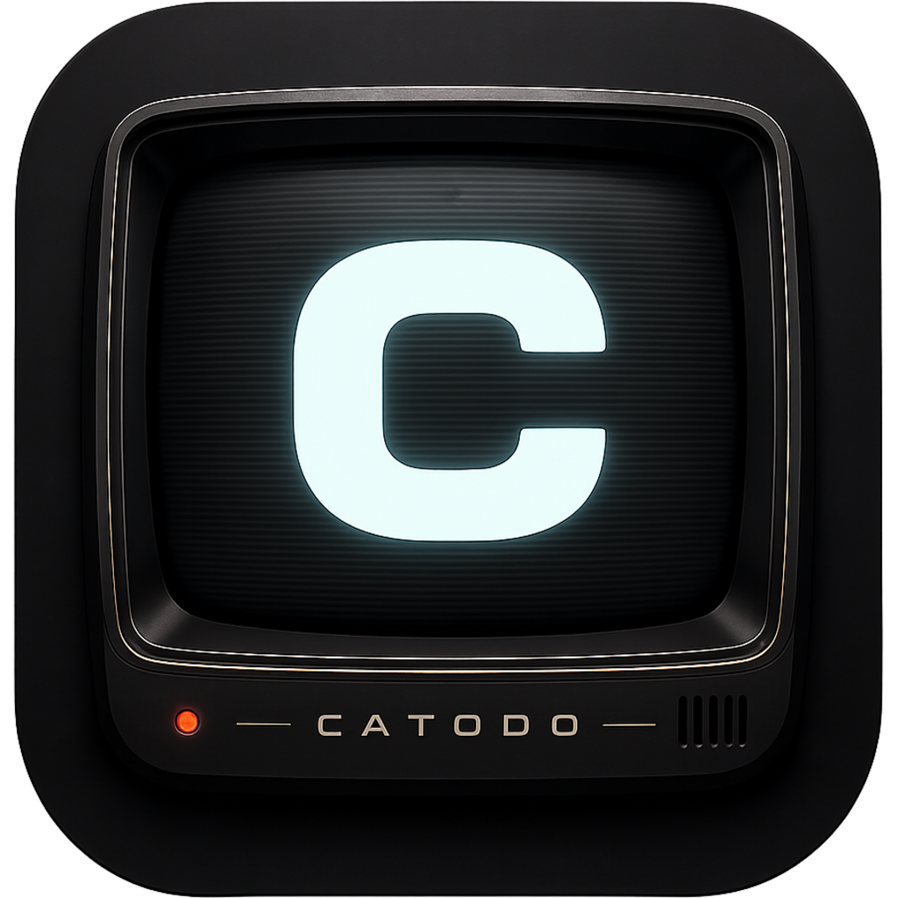

<p align="center">
  
</p>

# Cátodo

**Tu monitor vuelve a ser una TV.**

Kiosko multimedia para Linux y macOS inspirado en los televisores CRT. Canales
de pantalla completa, arcade con libretro embebido y bibliotecas locales, sobre
un backend Rust y un shell Electron en kiosko. Sin escritorio, sin cuenta y sin
telemetría.

El repo es un monorepo: el backend vive en `rust/`, la app Electron/React en
`frontend/`, los estáticos en `backend/static/` y los canales web declarativos en
`plugins-repo/`.

## Web

Landing y descargas: **[quicio.github.io/catodo](https://quicio.github.io/catodo/)**.
El sitio vive en `site/` y se publica con GitHub Pages desde `main`.

## Documentación

| documento | contenido |
|---|---|
| [`AGENTS.md`](AGENTS.md) | comandos y reglas duras para agentes |
| [`docs/HANDOFF.md`](docs/HANDOFF.md) | estado, invariantes y verificación |
| [`docs/ROADMAP.md`](docs/ROADMAP.md) | milestones y criterios de salida |
| [`docs/ARCHITECTURE.md`](docs/ARCHITECTURE.md) | capas, contrato `Channel`, plugins y puertos |
| [`docs/adr/`](docs/adr/) | decisiones con contexto y alternativas |
| [`openspec/specs/`](openspec/specs/) | specs vigentes por capacidad |
| [`openspec/changes/`](openspec/changes/) | cambios en curso y archivados |

## Uso

### Canales

- **Spotify** — Desktop Spotify controlado por MPRIS, con now-playing y letras sincronizadas.
- **YouTube** — YouTube TV en un webview (plugin bundled, user-agent Android TV).
- **Arcade** — Biblioteca local con player libretro embebido y marcos CRT.
- **IPTV** — TV en vivo por M3U/M3U8 con zapping.
- **Screen Cast** — Recibe una sesión de proyección desde el remote.
- **Canales de emisión** — Bibliotecas locales configurables (series/temporadas o videos planos), creadas desde Ajustes → Emisión. No hay un canal Anime implícito.
- **TV, Crunchyroll, Max y proveedores** — Plugins del catálogo; se instalan desde Ajustes → Canales.

Los canales `web` son **plugins declarativos**: se definen con un `manifest.json`
y se gestionan desde Ajustes o por API (ver [Plugins](#plugins)).

No hay atajos numéricos directos: chocarían con los formularios de los
canales. **Tab** abre/cierra el menú vertical de canales y **Alt+C** + número
salta a cualquier canal; el OSD superior muestra el número al cambiar.

## Instalación

Tres caminos, del más fácil al de más control:

| modo | comando | cuándo |
|---|---|---|
| **Release** (recomendado) | `curl -fsSL https://quicio.github.io/catodo/install.sh \| bash` | usar la última versión sin compilar |
| **Compilado local** | `./install-local.sh` | clonar el repo y compilar tu propia build |
| **Desarrollo** | `./run-dev.sh` | tocar código con Vite + Electron (HMR) |

### Release: un comando (Linux y macOS)

```bash
curl -fsSL https://quicio.github.io/catodo/install.sh | bash
```

El script detecta el sistema y elige solo:

- **Linux**: instala el paquete del gestor de la distro (`.pkg.tar.zst` con
  pacman, `.deb` con apt, `.rpm` con dnf/zypper) o, si no hay gestor, la
  AppImage. Verifica el SHA-256 contra `SHA256SUMS.txt` y aborta si no coincide.
  Registra Cátodo en el menú y retira instalaciones viejas de
  `~/.local/opt/Catodo`.
- **macOS**: usa Homebrew (`brew install --cask quicio/tap/catodo`) si está
  instalado; si no, baja el `.zip`, lo copia a `/Applications` y quita la
  cuarentena de Gatekeeper.

Variantes:

```bash
# macOS con Homebrew, directo
brew install --cask quicio/tap/catodo

# fijar versión
curl -fsSL https://quicio.github.io/catodo/install.sh | bash -s -- --version v0.14.0
# sin sudo: AppImage en ~/.local / .app en ~/Applications
curl -fsSL https://quicio.github.io/catodo/install.sh | bash -s -- --user
# ver sistema, método y asset elegido, sin descargar
curl -fsSL https://quicio.github.io/catodo/install.sh | bash -s -- --check
# desinstalar (los datos de ~/.local/share/catodo se conservan)
curl -fsSL https://quicio.github.io/catodo/install.sh | bash -s -- --uninstall
```

El backend Rust viaja como sidecar dentro de la app: no hay servicio systemd
que configurar ni pasos extra. En macOS la app no está notarizada; el
instalador limpia la cuarentena, pero si Gatekeeper insiste:

```bash
xattr -dr com.apple.quarantine /Applications/Catodo.app
```

Homebrew 5+ puede pedir confiar en el tap: `brew trust quicio/tap`.

Para revisar el script antes de ejecutarlo:

```bash
curl -fsSL https://quicio.github.io/catodo/install.sh -o install.sh
less install.sh && bash install.sh
```

Alternativa manual — cada release publica los paquetes y el tarball:

| asset | instalación |
|---|---|
| `Catodo-<ver>-linux-x86_64.AppImage` | `chmod +x` y ejecutar |
| `Catodo-<ver>-linux-amd64.deb` | `sudo apt install ./Catodo-<ver>-linux-amd64.deb` |
| `catodo-<ver>-1.x86_64.rpm` | `sudo dnf install ./catodo-<ver>-1.x86_64.rpm` |
| `catodo-<ver>-1-x86_64.pkg.tar.zst` | `sudo pacman -U catodo-<ver>-1-x86_64.pkg.tar.zst` |
| `Catodo-<ver>-mac-arm64.zip` | descomprimir y arrastrar `Catodo.app` a `/Applications` |
| `catodo-<ver>-src.tar.gz` | `./install-local.sh --check` y `./install-local.sh` |

### Compilado local (desde el código)

```bash
bash install-local.sh --check    # valida requisitos, sin modificar el sistema
bash install-local.sh            # compila e instala
```

Compila el backend Rust + frontend + AppImage. En Linux deja el backend como
servicio systemd de usuario y registra la app en el menú; en macOS el backend
corre como sidecar de la app. La AppImage queda en `frontend/release/` y se
copia a `~/.local/opt/catodo/Catodo.AppImage` (nombre estable) para el menú.

Flags: `--yes` (instala dependencias sin confirmar), `--autostart` (arranque al
login), `--no-cloudflared`.

### Desarrollo

```bash
cd frontend && npm ci          # una vez; el gate necesita node_modules
./scripts/check.sh             # tsc + versión + Rust
./run-dev.sh                   # backend + Vite libres + Electron
```

Backend solo:

```bash
cd rust
cargo run -p catodo-server     # http://127.0.0.1:8769
cargo test --workspace
```

Detalles de empaquetado, permisos TCC y limitaciones de macOS: ver
[macOS (Apple Silicon)](#macos-apple-silicon).

## macOS (Apple Silicon)

Cátodo corre de forma nativa en macOS Apple Silicon con la misma experiencia que en Linux. El backend, YouTube, los canales de emisión, Arcade, IPTV, remote, screencast y los 10 temas funcionan sin cambios. Hay algunas diferencias que conviene conocer.

### Requisitos

| Herramienta | Para | Cómo |
|---|---|---|
| **brew** | instalar el resto | <https://brew.sh> |
| **rust** | backend | `brew install rust` o <https://rustup.rs> |
| **node 20+** | build del frontend | `brew install node` |
| **cliclick** (opcional) | remote trackpad con primitivas relativas | `brew install cliclick` — sin esto, el remote usa `osascript` como fallback (limitado) |
| **ffmpeg** (opcional) | IPTV futura (stream proxy) | `brew install ffmpeg` |

### Dev local

```bash
git clone <repo> ~/catodo && cd ~/catodo
bash install-local.sh --check  # verifica requisitos (sin modificar el sistema)
bash install-local.sh          # compila backend + frontend (sin sudo)
./run-dev.sh                  # puertos libres + backend + Vite + Electron
```

`./run-dev.sh` elige puertos libres para el backend (8765→8799, saltando prod `:8767`) y Vite (1420→1460), y lanza Electron apuntando a Vite. Reusa el backend/Vite de este checkout si siguen sanos. Para una segunda instancia del mismo checkout: `./run-dev.sh --force-new`; para no reusar: `--no-reuse`; para sólo ver los puertos: `--dry-run`. El Electron de `node_modules` es el build de castLabs (ECS) con Widevine; `npm ci` descarga el binario y el CDM se instala al primer arranque.

### Empaquetado

```bash
bash build.sh    # produce release/Catodo-*.zip con Catodo.app + backend embebido
```

El `.app` resultante incluye el build de castLabs (ECS) con Widevine, igual que el AppImage. El build lo firma ad-hoc; sin notarización, la primera apertura todavía puede mostrar el warning de Gatekeeper.

### Limitaciones conocidas

- **Spotify requiere Spotify.app instalado.** Ch1 funciona vía AppleScript contra `application "Spotify"`. Si no tenés Spotify desktop instalado, Ch1 se omite del registry sin error (mismo gating que el resto del OS). **Permisos TCC**: la primera vez que abras Spotify desde el kiosk o el remote, macOS pide permiso de **Automation** a Spotify para el shell que corre el backend (Terminal/iTerm/Ghostty/etc). Sin ese permiso, AppleScript falla silencioso — el kiosk sigue pero Spotify no responde. Aprobá desde **System Settings → Privacy & Security → Automation** → permitir el proceso del backend.
- **Widevine empaquetado, VMP de desarrollo.** El CDM se instala en runtime, pero la firma VMP que trae ECS es la de desarrollo: si un proveedor exige VMP de producción (o licencias persistentes) hace falta firmar con [EVS](https://github.com/castlabs/electron-releases/wiki/EVS). Movistar/HBO Max en modalidad streaming usan licencias temporales y funcionan con la firma de desarrollo.
- **Autostart no automático en builds desde fuente.** La instalación por Homebrew usa la app única; para builds desde fuente, agregá `./run-prod.sh` a Login Items o usá Automator.
- **Notarización Apple ausente.** El build firma ad-hoc; si Gatekeeper bloquea la primera apertura, usá click derecho → Abrir o `xattr -dr com.apple.quarantine /Applications/Catodo.app`.

### Permisos TCC (cliclick/osascript)

La primera vez que uses el remote trackpad (mouse move/click) o inyeción de teclado desde el remote, macOS va a pedir permiso para que Terminal/iTerm/lo-que-corra-el-backend controle accesibilidad:

**System Settings → Privacy & Security → Accessibility** → habilitá el proceso que corre el backend (Terminal, iTerm, Ghostty, etc.). Sin este permiso, `osascript` falla con `Not authorized` y `cliclick` ignora los inputs.

### Estructura cross-platform

El backend usa arquitectura hexagonal para los subsistemas OS-touched:

- `catodo/domain/ports.py` — contratos (`MixerPort`, `InputInjectorPort`, `UriOpenerPort`, `SpotifyClientPort`)
- `catodo/infrastructure/linux/` — adapters Linux (wpctl/pactl, ydotool/xdotool, xdg-open, DbusSpotifyClient)
- `catodo/infrastructure/macos/` — adapters macOS (OsascriptMixer, CliclickInjector, MacOpenUriOpener, DbusslessSpotifyClient)
- `catodo/infrastructure/factory.py` — selecciona según `platform.IS_MACOS`
- `catodo/main.py:44 lifespan()` — composition root: instancia adapters una vez y los guarda en `app.state`

Para agregar Windows o un nuevo adapter, sólo se toca `infrastructure/<plataforma>/` + la factory.

## Production install

Desde los paquetes de la release (no compila nada):

| asset | instalación |
|---|---|
| `Catodo-<ver>-linux-amd64.deb` | `sudo apt install ./Catodo-<ver>-linux-amd64.deb` |
| `catodo-<ver>-1.x86_64.rpm` | `sudo dnf install ./catodo-<ver>-1.x86_64.rpm` |
| `catodo-<ver>-1-x86_64.pkg.tar.zst` | `sudo pacman -U catodo-<ver>-1-x86_64.pkg.tar.zst` |
| `Catodo-<ver>-linux-x86_64.AppImage` | `chmod +x` y ejecutar |
| `Catodo-<ver>-mac-arm64.zip` | descomprimir y mover a `/Applications` |

El `.rpm` y el `.pkg.tar.zst` los arma `scripts/package-extra-formats.sh` con nfpm a
partir del árbol del `.deb` que ya genera electron-builder, así que el contenido es
el mismo; solo cambia el formato y las dependencias declaradas. En Arch, además,
está previsto `catodo-bin` en el AUR (`packaging/aur/`), dormido hasta que reabra el
registro.

Desde el código:

```bash
# Verificar requisitos sin modificar el sistema (recomendado primero)
bash install-local.sh --check

# Instalación completa (detección de distro + deps del sistema + service + AppImage)
bash install-local.sh

# Opciones
bash install-local.sh --autostart   # habilita arranque automático del backend al login
bash install-local.sh --yes         # instala deps del sistema sin confirmar
```

Esto detecta la distro (`/etc/os-release`) y el gestor de paquetes (`pacman` /
`apt` / `dnf` / `zypper`), verifica e instala las dependencias del sistema
(cargo/Rust, node/npm, openssl, iproute2, xdotool/ydotool, pipewire/pulseaudio),
y luego:

1. Compila el backend Rust (`cargo build --release -p catodo-server`)
2. Build del frontend
3. Genera el unit `catodo.service` con las rutas reales del repo y del binario
4. Instala y arranca el servicio de usuario (`systemctl --user enable --now`)
5. Build del Electron AppImage

El instalador resuelve las rutas desde la ubicación real del repositorio, así
que funciona clonando el proyecto en cualquier directorio (no depende de
`~/projects/catodo`).

**Widevine:** los canales DRM (Movistar TV, Max, Netflix, Disney+, etc.) necesitan Widevine. Cátodo
empaqueta Electron for Content Security (castLabs), que instala el CDM en
runtime; no hay que instalar nada aparte, ni en dev ni en los artefactos
publicados.

## Hotkeys (inside the Cátodo window)

- `Tab` — abre/cierra el menú vertical de canales
- `Alt+C` + número — salto directo a cualquier canal (ej. `Alt+C`, `1`, `1` → canal 11); Enter o espera corta
- `+` / `-` / `ArrowUp` / `ArrowDown` — volumen (las flechas no aplican en IPTV)
- `F11` — pantalla completa
- `Esc` — salir de pantalla completa / volver al Home

Los atajos personalizados se crean en **Ajustes → Atajos**: combos `Alt+…` para
abrir un canal, Home, el menú, Ajustes, volumen, canal siguiente/anterior o
pantalla completa. También se puede cambiar el prefijo del salto (`channel_jump_combo`).
Las claves `channel_jump_combo` y `shortcuts` viven en el runtime config.

## Bibliotecas de medios

Cada **canal de emisión** es una biblioteca local configurable que escanea una
carpeta y se registra como canal propio. Se administra desde **Ajustes → Emisión**
o por API.

- `kind: series` → agrupa por serie + temporada.
- `kind: videos` → lista plana de videos (acepta `movies` legacy).
- Nombre, carpeta, icono, color y orden configurables.
- Progreso/resume aislado por canal.
- No hay un canal Anime built-in: si querés Anime, creá un canal apuntando a
  `~/Anime`. `anime_dir` queda como clave legacy sin efecto.

```bash
# agregar un canal de emisión (aparece al instante)
curl -X POST http://127.0.0.1:8765/api/libraries \
  -H 'Content-Type: application/json' \
  -d '{"name":"Saint Seiya","path":"/media/Saint Seiya","kind":"series","icon":"clapperboard","color":"#ffcc00","order":20}'

# editar (nombre, ruta, modo, icono, color u orden)
curl -X PATCH http://127.0.0.1:8765/api/libraries/saint-seiya \
  -H 'Content-Type: application/json' \
  -d '{"name":"Saint Seiya Clásico","kind":"series"}'

curl -X DELETE http://127.0.0.1:8765/api/libraries/saint-seiya
``````

La lista vive en `~/.local/share/catodo/config.json` → `libraries`.

## Arcade

El canal **Arcade** convierte el TV en una máquina recreativa: lista una biblioteca
local de juegos por sistema y lanza cada uno en un **emulador externo** (RetroArch,
MAME, …) a pantalla completa. Al cerrar el emulador, vuelve al launcher.

Layout de `~/Arcade` (o el dir que configures). Soporta **tres formas**:

```
# 1) ROMs sueltas por sistema + carátula sidecar (mismo nombre, .png/.jpg/.jpeg)
~/ROMs/
├── snes/
│   ├── Super Mario World.smc
│   └── Super Mario World.png     # carátula opcional
└── genesis/
    ├── Sonic.smd
    └── Sonic.png

# 2) Una subcarpeta por juego con boxart.png
~/Arcade/
└── NES/
    └── Pac-Man/
        ├── pacman.nes
        └── boxart.png            # boxart.png | jpg | jpeg

# 3) ROMs sueltas en la raíz del dir (se agrupan como un solo sistema)
```

Config (`~/.local/share/catodo/config.json`):

```json
{
  "arcade_dir": "~/Arcade",
  "arcade_emulators": { "NES": "retroarch -L ~/.config/retroarch/cores/fceumm_libretro.so {rom}" },
  "arcade_default_emulator": "mame {rom}"
}
```

- `arcade_emulators`: mapa `sistema → comando`; `{rom}` se reemplaza por la ruta de la ROM.
- `arcade_default_emulator`: comando para sistemas sin mapeo.
- El comando debe abrir el emulador a pantalla completa (ej. RetroArch con `--fullscreen`).
- Mientras corre el emulador, el sistema se mantiene activo (no entra en screensaver).
- `arcade_monitor_frame` (bool), `arcade_monitor_curvature` (0–0.2) y
  `arcade_monitor_black_border` (0–24 px) controlan el marco de TV CRT del
  player embebido. Con una partida abierta, **F1** o el botón **TV** del player abre los ajustes y
  los aplica en vivo.
- `arcade_monitor_mode` elige el marco `css` (dibujado por Cátodo) o `image`
  (imagen PNG/WebP con la pantalla transparente). Viene incluido el frame
  vintage en `/arcade/vintage-crt.webp`; también se puede **subir una imagen**
  desde Ajustes → Arcade. `arcade_monitor_screen_left|top|width|height`
  calibran la zona de pantalla del frame subido (porcentajes).

### Carátulas automáticas

Si un juego no tiene carátula local, Cátodo intenta descargarla solo desde
**Libretro Thumbnails** (`thumbnails.libretro.com`) al escanear, y la guarda como
sidecar (`<ROM>.png` al lado de la ROM). Es best-effort: si el nombre del ROM no
coincide con la convención no-intro de Libretro, queda el placeholder.

- La descarga es serializada y los intentos fallidos no se repiten en cada escaneo.
- Config: `arcade_boxart_enabled` (default `true`) para desactivarla.
- Retry manual por API:
  ```bash
  # un juego puntual
  curl -X POST http://127.0.0.1:8765/api/channels/arcade/command \
    -H 'Content-Type: application/json' \
    -d '{"command":"fetch_boxart","game":"snes/Super Mario World"}'
  # forzar el lote completo de faltantes
  curl -X POST http://127.0.0.1:8765/api/channels/arcade/command \
    -H 'Content-Type: application/json' \
    -d '{"command":"fetch_boxarts"}'
  ```

## Remote en el celular (PWA + QR)

El remote (`/remote/`) es una **PWA**: en el iPhone abrí la URL en Safari, tocá
**Compartir → Agregar a pantalla de inicio** y queda instalado como app fullscreen.
En Android/Chrome aparece el banner **"Instalar como app"** automáticamente.

Para conectar sin tipear la IP: en la TV abrí el **Home** y tocá el botón **📱** —
aparece un **QR** que escaneás con la cámara del iPhone y te abre el remote
directamente. El QR codifica la URL **pública** (si tenés un túnel configurado, ver
abajo) o la **LAN** como fallback. Como fallback extra, el remote tiene un campo
**código/token de emparejamiento** en Settings.

| Endpoint                  | Descripción                                                  |
| ------------------------- | ------------------------------------------------------------ |
| `GET /api/pair/info`      | URLs (LAN + pública) + código de emparejamiento              |
| `GET /api/pair/qr`        | QR (SVG) con la URL primaria (`?which=lan` para forzar LAN)  |

> **Administración local-only**: el remote emparejado controla reproducción,
> canales, volumen, tema, layout e idle. No puede cambiar rutas de bibliotecas,
> comandos de emuladores, repo de plugins, túnel, MQTT ni tokens: esas opciones
> se configuran en la TV (loopback) y un request externo recibe 403 (ADR-0012).
> En **Ajustes → General → Remotos vinculados** podés revocar un teléfono; su
> token deja de autenticar al instante. Los tokens vencen a los 30 días por
> defecto (`pair_token_ttl_days`; `0` = sin vencimiento).

## Dominio público y túnel (HTTPS válido desde internet)

Por defecto el remote y `/cast` solo funcionan en tu WiFi (LAN). Para exponer
Cátodo a internet con HTTPS válido y que el QR funcione desde 4G o desde
afuera de tu casa, Cátodo puede administrar un **túnel público** con un
dominio propio. La primera implementación usa **Cloudflare Tunnel**
(`cloudflared`), pero la arquitectura es pluggable — agregar Tailscale o
ngrok es agregar un provider nuevo sin tocar el resto del sistema.

**Prerequisitos únicos (one-time):**
1. Un dominio propio delegado a Cloudflare (~$10/año).
2. En el panel de Cloudflare: **Zero Trust → Networks → Tunnels** → crear un
   tunnel de tipo **Cloudflared** → copiar el token JSON.
3. Apuntar un **CNAME** de tu subdominio (ej. `catodo.tudominio.com`) al
   tunnel que acabás de crear.

**Configuración en Cátodo (runtime):**
1. En el Home, abrí ⚙ → **DOMINIO PÚBLICO** → **Mostrar túnel**.
2. Completá:
   - **Dominio público**: `catodo.tudominio.com`
   - **Provider**: `cloudflare` (default)
   - **Ruta del token**: ruta absoluta al JSON que bajaste (ej.
     `~/.cloudflared/<tunnel-uuid>.json`)
   - **Habilitar túnel al arrancar**: ✓
   - **Exigir token en /api/\***: ✓ (recomendado)
3. **Guardar** y luego **Iniciar**. El indicador pasa a verde cuando
   `https://catodo.tudominio.com/api/health` responde.

Desde ese momento el **botón � del Home muestra un QR con
`https://catodo.tudominio.com/remote?code=…`**. Tu celular lo abre desde
cualquier red, Safari/Chrome ofrece **"Agregar a pantalla de inicio"**, y la
app queda instalada como PWA fullscreen. `/cast` también funciona sobre el
dominio público sin pedirte que aceptes un cert self-signed.

El binario `cloudflared` se descarga solo la primera vez (`scripts/install_cloudflared.sh`,
incluido por defecto en `install-local.sh` — usá `--no-cloudflared` para omitirlo).

### Alternativa sin dominio propio: Tailscale Funnel

Si todavía no tenés un dominio delegado a Cloudflare (o no querés migrar los
NS), podés probar todo el módulo con **Tailscale Funnel**, que te da HTTPS
válido en `https://<node>.<tailnet>.ts.net` sin registrar dominio:

1. Instalá Tailscale: `curl -fsSL https://tailscale.com/install.sh | sh`
2. Autenticá: `tailscale up` (te abre un browser para login)
3. En Cátodo, abrí ⚙ → **DOMINIO PÚBLICO** → **Mostrar túnel**:
   - **Provider**: `tailscale-funnel`
   - **Habilitar túnel al arrancar**: ✓
4. **Iniciar**. El botón 📱 del Home pasa a mostrar el QR con
   `https://<tu-node>.ts.net/remote?code=…`.

Funciona end-to-end (QR público, PWA instalable, `/cast` con HTTPS válido),
y cuando migres los NS a Cloudflare, cambiás `tunnel_provider` de
`tailscale-funnel` a `cloudflare` y completás **Dominio público** + **Ruta
del token**. Sin tocar una línea de código.

> Tailscale Funnel tiene un límite de tráfico en el plan free. Para uso
> doméstico alcanza; para algo pesado conviene migrar a Cloudflare.

| Endpoint                    | Descripción                                                  |
| --------------------------- | ------------------------------------------------------------ |
| `GET  /api/tunnel/status`   | Estado del túnel (`stopped|starting|running|failed|degraded`) |
| `GET  /api/tunnel/health`   | Reachability + latencia del dominio público                  |
| `GET  /api/tunnel/providers`| Providers registrados y si están configurados                |
| `POST /api/tunnel/start`    | Inicia el túnel                                              |
| `POST /api/tunnel/stop`     | Detiene el túnel                                             |

El backend publica eventos `tunnel_state` por WebSocket para que el Home
reaccione en vivo sin recargar.

## Apariencia (temas y personalización)

Cátodo tiene **10 temas** que cambian colores, tipografía, forma de los botones,
densidad, efectos (CRT/glow) y **pack de iconos**. Se eligen desde el botón ⚙ del
Home (sección **TEMAS**) y aplican al instante en la TV y el remote.

| Tema | Inspiración | Fuente | Iconos | Bordes | Densidad | Efectos |
| ---- | ----------- | ------ | ------ | ------ | -------- | ------- |
| Spotify Dark (default) | Spotify | Space Grotesk | Lucide | redondos | media | CRT |
| Retro CRT | terminales de fósforo | VT323 | Game Icons | cuadrados | media | CRT + glow |
| Minimal Light | minimalismo | Inter | Feather | redondos | media | — |
| Orbital Blue | launcher PS2/XMB | Orbitron | Phosphor | píldora | espaciosa | glow |
| Estuary | Kodi | Oswald | Material | cuadrados | compacta | — |
| Smart TV Coral | webOS/Tizen | Nunito | Ionicons | píldora | espaciosa | — |
| Cone Orange | VLC / reproductores | Inter | Bootstrap | redondos | compacta | — |
| Amber Vintage | terminales ámbar | IBM Plex Mono | Codicons | cuadrados | media | CRT + glow |
| Cyber Neon | futurismo | Orbitron | Tabler | redondos | compacta | glow |
| Paper Mono | e-ink | Inter | Radix | cuadrados | media | — |

### Personalizaciones

En la sección **PERSONALIZACIÓN** del mismo panel se puede sobreescribir cualquier
dimensión sin cambiar de tema: fuente, pack de iconos, bordes, densidad, CRT y glow.
Cada control tiene la opción **"Tema"** que quita el override y vuelve al valor del
tema activo. Los overrides se guardan en `theme_overrides` (config.json) y sobreviven
a cambios de tema y reinicios.

### Temas custom

Se definen en `~/.local/share/catodo/config.json` bajo `themes`. Con `base` heredan
de un tema existente y solo definen lo que cambian:

```jsonc
{
  "themes": [
    {
      "id": "mi-tema",
      "name": "Mi Tema",
      "base": "cyber-neon",        // hereda tipografía, bordes, densidad, efectos e iconos
      "colors": { "accent": "#ff00ff" }
    }
  ]
}
```

Los colores se validan (`#hex`, `rgb(a)`, `hsl(a)`); un tema inválido se descarta con
un warning en el log sin afectar al tema activo. Los temas v1 (solo `tokens` + `crt`)
siguen funcionando: heredan el resto de dimensiones del tema por defecto.

El **remote PWA** adopta automáticamente la paleta y los bordes del tema activo
(los packs de iconos son solo del kiosk).

## Proyección de pantalla (Screen Cast)

Cátodo funciona como **pantalla inalámbrica** vía WebRTC (sin protocolos propietarios):

1. En la TV hay un canal **Pantalla** (`screen-cast`); al iniciarse una proyección se abre solo.
2. En cualquier navegador abrí `https://<tu-dominio>/cast/` (si tenés túnel público activo) o
   `https://<ip-catodo>:8766/cast/` (cert self-signed en LAN), tocá **Compartir pantalla** y listo.
3. Desde el **remote** aparece un indicador "Proyectando" con botón para detener.

**Requisito HTTPS**: `getDisplayMedia` (compartir pantalla) solo funciona en contexto seguro
(HTTPS o `localhost`). Con un dominio público y el túnel activo, `https://<tu-dominio>/cast/`
tiene cert válido y no pide aceptar nada. Si preferís LAN con cert local, sigue disponible:

```bash
bash scripts/make_cert.sh        # genera ~/.local/share/catodo/ssl/{cert,key}.pem
systemctl --user restart catodo  # ahora también escucha HTTPS en :8766
```

Luego abrís `https://<ip-catodo>:8766/cast/` (aceptá el certificado self-signed una vez) y
compartís pantalla. El resto de la app (TV, remote, QR) sigue por HTTP sin cambios.

Limitación: requiere un navegador que soporte `getDisplayMedia` (PC; los celulares Android/iOS
no exponen captura de pantalla). El media va peer-to-peer; STUN público incluido, sin TURN.

## Salir del kiosko

La app corre en pantalla completa, sin menú de aplicación. Para cerrarla:

- **⌘⇧Q** en macOS (`Ctrl+Shift+Q` en Linux) → pide confirmación y cierra el
  kiosko junto con el backend embebido.
- **Ajustes → General → Salir de Cátodo** (el botón hace lo mismo).
- `Esc` sólo sale del canal activo y vuelve al Home; no cierra la app.

## Reposo / screensaver

Cátodo detecta inactividad y se comporta como una TV: tras `idle_screensaver_seconds`
sin input muestra una pantalla de reposo (wallpapers + reloj); si configurás
`idle_sleep_seconds` (> 0), después apaga la pantalla (negra). Cualquier input
(mouse/teclado del kiosk o el remote) lo reactiva y vuelve al canal anterior.

- Config: `~/.local/share/catodo/config.json` → `idle_screensaver_seconds` (default 240)
  e `idle_sleep_seconds` (default 0 = desactivado). Editables desde el **Settings**
  del remote o por API.
- `POST /api/activity` es el ping de actividad local del kiosk.

## Resume de sesión

Al encender, Cátodo retoma el último canal activo en vez de arrancar en el Home
(comportamiento tipo TV). Se desactiva con `resume_last_channel: false` en
`~/.local/share/catodo/config.json`. Si el canal guardado ya no existe, arranca
en el Home sin error.

## Volumen por canal

Cada canal recuerda su propio volumen: al cambiar de canal se aplica el del
nuevo y al volver se restaura el anterior. Config:

- `per_channel_volume_enabled` (default `true`) — desactivar para volumen global.
- `per_channel_volume_default` (default `50`) — volumen para canales sin nivel guardado.
- `channel_audio_sinks` — mapa `canal → sink` de PulseAudio; al abrir el canal,
  el sink por defecto del sistema se mueve a ese sink (se ignora si no hay PulseAudio).

```json
{ "channel_audio_sinks": { "spotify": "bluez_output.XX_XX_XX_XX" } }
```

## Control por voz

Cátodo interpreta comandos de voz (recibe texto ya transcrito, sin STT propio).
`POST /api/voice` con `{"text": "poné YouTube"}` abre el canal; también entiende
"canal 2", "siguiente", "anterior", "sube/baja el volumen", "pausa", "play",
"home" y "pantalla". El kiosk muestra un overlay breve con lo que entendió.

## Domótica (MQTT)

Cátodo puede conectarse a un broker MQTT (cubre Zigbee vía zigbee2mqtt). Config:

```json
{ "mqtt_host": "192.168.1.10", "mqtt_port": 1883, "mqtt_user": "", "mqtt_pass": "", "mqtt_topic_prefix": "catodo" }
```

Sin `mqtt_host`, el bridge no arranca. Comandos entrantes en `catodo/cmd/<cmd>`:

| Tópico              | Payload                          |
| ------------------- | -------------------------------- |
| `catodo/cmd/channel`| id o nombre de canal (`youtube`, `poné arcade`) |
| `catodo/cmd/next`   | —                                |
| `catodo/cmd/prev`   | —                                |
| `catodo/cmd/volume` | nivel (`40`) o `+`/`-`           |
| `catodo/cmd/play` / `pause` / `home` | —                  |

El estado se publica en `catodo/state` (retain): `{"channel", "volume", "playing"}`.
Ejemplo en Home Assistant:

```yaml
mqtt:
  button:
    - name: "TV YouTube"
      command_topic: "catodo/cmd/channel"
      payload_press: "youtube"
    - name: "TV siguiente"
      command_topic: "catodo/cmd/next"
```

## Plugins

Cátodo tiene un sistema de plugins declarativos inspirado en los addons de Kodi:
un plugin es una carpeta `plugins/<id>/` con un `manifest.json` que describe un
canal `web` (URL + user-agent + partition + color), sin código. El repo
(`plugins-repo/`) es el **catálogo**: sólo YouTube es `bundled: true` y se
autoinstala. TV, Crunchyroll, Max, Netflix, Disney+, Movistar, Claro, Apple TV+,
Paramount+ y Pluto TV son `bundled: false` y se instalan desde **Ajustes →
Canales** o por API.

```json
// manifest.json de un plugin web
{
  "id": "mi-canal",
  "name": "Mi Canal",
  "version": "1.0.0",
  "type": "web",
  "icon": "play",
  "color": "#f47521",
  "url": "https://ejemplo.com",
  "user_agent": "default",          // default | chrome | android-tv
  "partition": "persist:mi-canal",
  "order": 6,                       // posición en el menú (opcional)
  "drm": true,                      // requiere Widevine (aviso en la UI)
  "config_key": "mi_canal_url",     // override legacy de URL (opcional)
  "requires_catodo": { "min": "0.1.0" },
  "dependencies": []                // ignorado: los plugins no ejecutan código
}
```

La URL de cualquier canal web se puede cambiar en caliente con la clave
`channel_<id>_url` (por ejemplo `channel_netflix_url`). Es **local-only**: el
remote/LAN no puede redirigir canales. `config_key` queda como fallback legacy.

### Gestión

Los plugins se gestionan por API (no hay CLI Python):

```bash
curl http://127.0.0.1:8767/api/plugins              # instalados
curl http://127.0.0.1:8767/api/plugins/catalog      # disponibles + instalados
curl -X POST http://127.0.0.1:8767/api/plugins/install \
  -H 'Content-Type: application/json' -d '{"id":"netflix"}'
curl -X POST http://127.0.0.1:8767/api/plugins/netflix/enable
curl -X POST http://127.0.0.1:8767/api/plugins/netflix/disable
curl -X POST http://127.0.0.1:8767/api/plugins/netflix/order \
  -H 'Content-Type: application/json' -d '{"order":1}'
curl -X DELETE http://127.0.0.1:8767/api/plugins/netflix
```

> Los cambios de estado se persisten en `~/.local/share/catodo/plugins.json`.
> Instalar registra el canal al instante; desinstalar lo quita sin reiniciar.
> Los bundled no se desinstalan: se deshabilitan. El orden (`order`) se puede
> fijar por plugin y sobrevive reinicios. Los canales con `drm: true` requieren
> ECS+Widevine y dependen de lo que permita cada proveedor con tu cuenta.

### Repos y dependencias

- El **repo por defecto** es `plugins-repo/` (en el repo git) con un `index.json`
  que lista plugins (id, versión, url o path, checksum `sha256`, `requires_catodo`).
  Se puede cambiar con `plugin_repo` en `~/.local/share/catodo/config.json` o
  `CATODO_PLUGIN_REPO`.
- Los plugins son **sólo declarativos**: no se ejecuta código de terceros y no
  se instalan dependencias pip. Un manifest con `dependencies` se ignora
  (ADR-0011).

## API

| Method | Path                            | Description                        |
| ------ | ------------------------------- | ---------------------------------- |
| GET    | `/api/health`                   | Liveness probe                     |
| GET    | `/api/channels`                 | List registered channels           |
| GET    | `/api/state`                    | Global state                       |
| GET    | `/api/channels/{id}/state`      | Per-channel state                  |
| POST   | `/api/channels/{id}/open`       | Switch to a channel                |
| POST   | `/api/channels/{id}/close`      | Close a channel                    |
| POST   | `/api/channels/{id}/command`    | Channel command (play, pause, ...) |
| POST   | `/api/channels/next`            | Next channel (cyclic)              |
| POST   | `/api/channels/previous`        | Previous channel (cyclic)          |
| GET    | `/api/channels/{id}/episodes`   | Channel episodes (emisión)         |
| GET    | `/api/channels/{id}/stream`     | Episode file stream (emisión)      |
| GET    | `/api/channels/{id}/boxart`     | Boxart image (Arcade)              |
| GET    | `/api/channels/{id}/history`    | Channel history (Spotify)          |
| POST   | `/api/volume?level=N\|+\|-`     | Set/adjust volume                  |
| POST   | `/api/type`                     | Type text into the active webview  |
| POST   | `/api/voice`                    | Voice command (text → action)      |
| GET    | `/api/lyrics?artist=&track=`    | Lyrics lookup via LRCLib           |
| GET    | `/api/config`                   | Runtime config (read)              |
| POST   | `/api/config`                   | Runtime config (write)             |
| GET    | `/api/plugins`                  | Installed plugin list              |
| GET    | `/api/plugins/catalog`          | Available + installed catalog      |
| GET    | `/api/plugins/{id}`             | Plugin detail                      |
| POST   | `/api/plugins/install`          | Install + register plugin (hot)    |
| DELETE | `/api/plugins/{id}`             | Uninstall non-bundled plugin (hot) |
| POST   | `/api/plugins/{id}/enable`      | Enable plugin (hot)                |
| POST   | `/api/plugins/{id}/disable`     | Disable plugin (hot)               |
| POST   | `/api/plugins/{id}/order`       | Set per-plugin order override      |
| GET    | `/api/libraries`                | Media library list                 |
| POST   | `/api/libraries`                | Add media library (hot channel)    |
| PATCH  | `/api/libraries/{id}`           | Edit media library (hot)           |
| DELETE | `/api/libraries/{id}`           | Remove media library (hot)         |
| GET    | `/api/wallpapers/list`          | Wallpaper file list                |
| GET    | `/api/wallpapers/count`         | Wallpaper count                    |
| POST   | `/api/wallpapers/fetch?n=`      | Download new wallpapers            |
| GET    | `/api/wallpapers/cover`         | Album cover via iTunes API         |
| GET    | `/api/wallpapers/artist?name=`  | Artist photos (Last.fm/Reddit)     |
| WS     | `/api/ws`                       | Live events (state snapshot on connect) |

## Layout

```
rust/       Backend Rust (axum) — crates domain, platform y server
backend/    static assets (frontend compilado + remote PWA) + systemd unit
frontend/   React + Vite + Electron (no Tauri)
```

Data stored outside the repo at `~/.local/share/catodo/`:
- `config.json` — runtime overrides (URLs, directories)
- `wallpapers/` — downloaded wallpapers and artist photos

## Estado

El estado medido, los invariantes y la deuda viven en
[`docs/HANDOFF.md`](docs/HANDOFF.md). El gate del repo es:

```bash
./scripts/check.sh        # tsc + versión + Rust (fmt, clippy, tests, capas)
```

Los releases los publica release-please desde `main`; cada tag `vX.Y.Z` dispara
los artefactos de macOS y Linux. El detalle está en
[`docs/ROADMAP.md`](docs/ROADMAP.md).

## Capturas

La landing con los mockups del Home, Arcade, remote y canales de emisión está en
**[quicio.github.io/catodo](https://quicio.github.io/catodo/)**. El código del
sitio vive en [`site/`](site/).

## Limitaciones conocidas

- **macOS**: sólo Apple Silicon y sin notarización de Apple. La primera apertura
  requiere clic derecho → Abrir o quitar la cuarentena.
- **DRM**: los proveedores con Widevine (Movistar, Max, Netflix, Disney+, etc.)
  dependen del runtime ECS y de lo que permita cada cuenta; no hay garantía de
  reproducción.
- **Plataformas**: hay builds de macOS arm64 y Linux x86_64; no hay Windows ni
  macOS Intel publicados.
- **Remoto**: la administración sensible (rutas, túneles, tokens, emuladores)
  queda local-only por diseño (ADR-0012).

## Roadmap

El backlog operativo vive en [`openspec/changes/`](openspec/changes/) y el orden
de ataque en [`docs/ROADMAP.md`](docs/ROADMAP.md). Regla del repo: un change de
OpenSpec, un milestone y un commit lógico.

## Privacidad

Cátodo no usa cuentas, cookies, analítica ni telemetría. La configuración,
bibliotecas, wallpapers, plugins y progreso viven en
`~/.local/share/catodo/`. Las funciones online (túnel, MQTT, búsqueda de letras,
wallpapers) son opt-in y se configuran desde Ajustes o el archivo de config.

Esta página del repo no usa cookies, analítica ni fuentes externas.

## Licencia

MIT. Ver [`LICENSE`](LICENSE).
